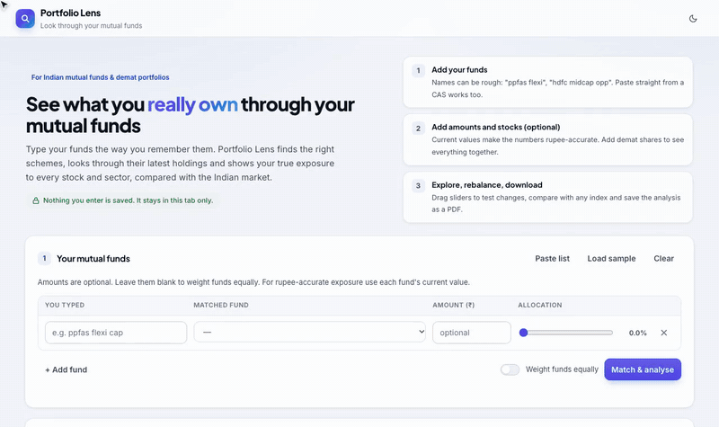

# Portfolio Lens

See which stocks and sectors you actually own through your Indian mutual funds (and any shares you hold directly), and compare that with the major Indian indices.

▶ [Watch the full-quality demo video (MP4, 38 s)](docs/demo.mp4)

## Run

    ./run.sh          # http://127.0.0.1:8765

The first run creates `.venv` and installs `requirements.txt`. To run the tests:

    .venv/bin/pip install -r requirements-dev.txt
    .venv/bin/python -m pytest -q tests

## How to use it

1. **Add your funds.** Type names the way you remember them ("ppfas flexi", "hdfc midcap opp") or paste rows from a CAS statement. Amounts are optional; use each fund's current value for rupee-accurate numbers.
2. **Add shares you hold directly** (optional), by ISIN or name.
3. **Click "Match & analyse".** Check the matched fund in each row and pick another from the dropdown if needed.
4. **Explore:** summary, sector exposure, stock map, top holdings by source fund, fund overlap, asset mix and every holding.
5. **Compare with an index** such as Nifty 500 or Midcap 150, and **drag the sliders** to test a rebalance.
6. **Download the PDF** report.

## Privacy

- **Nothing is saved.** Your funds, amounts and stocks live only in the open browser tab. Refreshing or closing it clears them (the page warns you first). Only the theme and chosen index are remembered.
- **The server keeps nothing on disk.** Public market data is cached in memory for up to 6 hours and is gone when the server stops. Request URLs are not logged, and API responses are sent with `Cache-Control: no-store`.
- **What leaves your machine:** only fund and stock lookups (names and ISINs) sent to Groww and mfapi.in to fetch public data. Your amounts never leave the browser, because every calculation runs in the page. The PDF is built in the browser and saved straight to your Downloads folder. The server only listens on 127.0.0.1.

## Features

- **Fuzzy fund matching** (`app/matching.py`): cleans statement noise (RTA codes like `SCDG -`, `(formerly …)` notes), expands nicknames (`ppfas`, `icici pru`) and renamed funds (Emerging Bluechip → Large & Midcap), searches Groww, and falls back to the official AMFI list for funds Groww's search misses. Every match comes with alternatives to pick from, and a weak match is never selected automatically, so a wrong fund or stock never sneaks into your numbers.
- **Look-through exposure:** ₹ in a stock = Σ amount in fund × stock's weight in that fund. Rows for the same scheme (several folios) are merged. Debt, cash and REITs are grouped by asset class.
- **Direct stocks** (`app/stocks.py`): demat holdings are matched by ISIN or name to the same stock ids the funds use, so a stock held both directly and through funds is counted as one exposure.
- **Index comparison** (`app/benchmarks.py`): compare with Nifty 50, Sensex, Next 50, Nifty 100, LargeMidcap 250, Nifty 500, MidSmallcap 400, Midcap 150 or Smallcap 250. Each index is represented by a fund that tracks it. You get overlap, how different you are from the index, size mix (SEBI buckets: Nifty 100 / Midcap 150 / Smallcap 250), sector weights side by side, and the stocks where you're most above and below the index.
- **Views:** summary numbers, sector bars (click to filter), stock map, top stocks split by source fund, fund-overlap grid, asset mix, and a searchable holdings table with a per-fund breakdown for each stock.
- **PDF report:** "Download PDF" (header or bottom of the page) builds a multi-page A4 report in your browser: a cover with summary and fund list, every chart, the index comparison and the top 50 holdings. html2canvas and jsPDF load from cdnjs only when you click.
- **Rebalance:** edit amounts or drag sliders and everything updates instantly. "Set as baseline" shows the change in percentage points.
- **Paste a list:** one per line, amount at the end (`ppfas flexi, 2.5L`, `quant small cap - 1,00,000`, or rows copied from a CAS).

## Re-recording the demo

The demo is scripted, so it can be re-recorded after UI changes. It uses only sample data. With the app running:

    .venv/bin/pip install -r requirements-dev.txt
    .venv/bin/playwright install ffmpeg      # small, one-time: Playwright's video encoder
    .venv/bin/python scripts/record_demo.py  # writes docs/demo.mp4 and docs/demo.gif

It drives your installed Google Chrome in headless mode.

## Data sources and caveats

Fund holdings, stock search and industry data come from Groww's unofficial public endpoints, and the AMFI scheme list from mfapi.in. These can change without notice. Holdings are monthly disclosures, so they lag by up to a month. Not investment advice.
